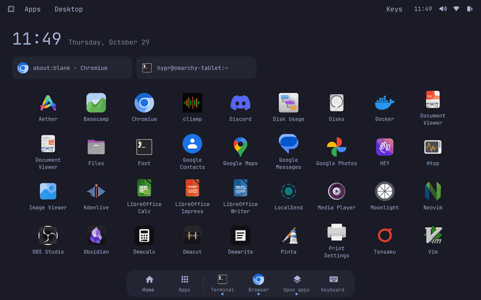

# Omarchy on the Alldocube iPlay 50 mini Pro (MediaTek MT8781 / Helio G99)

Native Arch Linux ARM + [Omarchy](https://github.com/basecamp/omarchy) (Hyprland) as the only
operating system on an Alldocube iPlay 50 mini Pro tablet, with Wi-Fi, speaker audio, touch,
auto-rotation, an on-screen keyboard, a GPU-composited desktop, hardware H264 video in
Chromium, and a touch-first "Home & Dock" shell. Work done 2026-10-27 to 2026-10-30.

> **Warning.** Following this guide **erases Android and all data** on the tablet, needs an
> unlocked bootloader, and writes boot partitions. Some partitions cannot be read back over
> fastboot, so a mistake can leave the tablet unbootable. Nothing here is supported by
> Alldocube, MediaTek, Google or the Omarchy project. Read
> [docs/01](docs/01-device-and-backups.md) (brick risks) completely before flashing anything.

## The tablet

The "Vendor spec" column comes from the [Alldocube product page](https://www.alldocube.com/en/products/iplay50minipro/).
The "Under this port" column was read from the project's unit while it ran Linux.

| | Vendor spec | Under this port |
|---|---|---|
| Model | iPlay 50 mini Pro (T811M, box CUL8JN) | Vendor build props: `ALLDOCUBE` / `Zhangwanmini`; lk product `tb8781p1_64` |
| SoC | MediaTek Helio G99 (MT8781, the tablet version of MT6789), 6 nm | Same |
| CPU | 2× Cortex-A76 + 6× Cortex-A55 | A76 cores (6–7) up to 2.2 GHz; A55 cores (0–5) up to 2.0 GHz |
| GPU | Arm Mali-G57 MC2 | `Mali-G57 2 cores r0p1`. Compositing via Zink + PanVK; apps render on the CPU ([08](docs/08-gpu.md)) |
| RAM | 8 GB (plus 8 GB "virtual RAM", Android swap) | 7.2 GiB usable |
| Storage | 256 GB, microSD up to 512 GB | UFS 3.1, 256 GB; ~228 GiB `userdata` is the Linux root. microSD **not tested** |
| Display | 8.4" in-cell IPS, 1200×1920 | Panel is natively portrait (1200×1920 on DSI-1); rotation via the accelerometer ([06](docs/06-sensors.md)) |
| Touch | (not listed) | `mtk-tpd`, works |
| Battery | 3.8 V / 5000 mAh Li-ion | Capacity from the gauge is unreliable ([11](docs/11-power-battery.md)); ~11.5 h screen-on runtime measured |
| Charging | 18 W PD fast charge, USB-C | Charges; only 5 V (~10 W max) was observed, on one wall charger ([11](docs/11-power-battery.md)) |
| USB | USB-C | USB 2.0 high-speed gadget (NCM network link for SSH) |
| Wi-Fi | Dual-band | 2.4 + 5 GHz, 802.11ac (VHT, 867 Mbps max link rate); WPA2 works ([05](docs/05-wifi-bluetooth.md)) |
| Bluetooth | 5.2 | Radio powers on; pairing **unverified** ([05](docs/05-wifi-bluetooth.md)) |
| Cellular | 4G LTE, VoLTE, dual SIM (or SIM + microSD) | Modem drivers load; not investigated |
| GPS | GPS + BeiDou | Not investigated |
| Audio | (not listed) | MT6366 codec: speakers work; built-in microphone not working; 3.5 mm jack untested ([07](docs/07-audio.md)) |
| Sensors | (not listed) | Accelerometer works; no gyroscope registered; light/proximity not investigated ([06](docs/06-sensors.md)) |
| Cameras | (not on the product page; retailers list 13 MP rear / 5 MP front) | Not investigated |
| Haptics | Vibration motor | Not investigated |
| Body | 7.5 mm thick, 307 g, metal | — |
| Shipped OS | Android 13 | Replaced by Arch Linux ARM + Omarchy; the kernel stays Android GKI 5.10.149 |

## Approach

Mainline Linux has no support for this SoC's Wi-Fi/Bluetooth (MT6631 connsys), audio or power
management. So the project runs the tablet's **own Android kernel**, the Halium-style route:

- **Kernel:** Google's exact GKI 5.10.149 (build `ab9703858`), rebuilt from source with only
  ABI-safe additions (DEVTMPFS, FHANDLE, AUTOFS, VT, PID/USER namespaces, an embedded initramfs).
  Every exported symbol CRC is identical, so all **stock vendor modules load unchanged**.
- **Boot:** lk boots it from `boot_a`. A small initramfs loads the first-stage vendor modules,
  loop-mounts `vendor` / `vendor_dlkm` read-only straight out of the `super` partition, and
  switches to an ext4 Arch Linux ARM root on the former Android `userdata` partition.
- **Hardware:** Android's userspace helpers are replaced with small native programs (connsys
  power-on, Bluetooth bridge, fuel-gauge handshake, sensor reader, V4L2 video bridge).
- **Desktop:** official ARM Omarchy 4.0.6 with user-level overrides only: packaged files are
  untouched (`pacman -Qkk omarchy`: 0 altered).

## Status

| Area | State | Doc |
|---|---|---|
| Boot (own GKI rebuild, stock vendor modules), SSH over USB | Works | [01](docs/01-device-and-backups.md), [02](docs/02-kernel.md), [03](docs/03-boot-and-rootfs.md) |
| Omarchy 4.0.6 desktop (UWSM, Quickshell shell, apps) | Works | [04](docs/04-omarchy.md) |
| Wi-Fi (WPA2) | Works; WPA3/SAE fails; `iwd` unusable (no AF_ALG) | [05](docs/05-wifi-bluetooth.md) |
| Bluetooth | Radio powers on; `hci0`/pairing/audio **unverified** | [05](docs/05-wifi-bluetooth.md) |
| Auto-rotation + touch alignment | Works (accelerometer; no gyroscope) | [06](docs/06-sensors.md) |
| Speaker audio (PipeWire) | Works; microphone, headset and BT audio not working or unvalidated | [07](docs/07-audio.md) |
| GPU: Hyprland compositing on Mali-G57 (Zink + PanVK on the vendor kbase) | Works; apps and browser stay on CPU rendering (llvmpipe) | [08](docs/08-gpu.md) |
| Hardware H264 decoding in Chromium (vendor VCU + V4L2 bridge) | Works up to 1080p30, survives reboot; other codecs not validated; some frame drops | [09](docs/09-video-decoding.md) |
| On-screen keyboard (tap a field → keys), touch shell, Kid Mode | Works; some items unverified | [10](docs/10-touch-ui.md) |
| Charging, battery % | Works; the percentage runs ~2× fast in the second half (1 % with 2.2 h left); ~11.5 h screen-on runtime | [11](docs/11-power-battery.md) |
| Suspend | **Untested** | [11](docs/11-power-battery.md) |
| Responsiveness work and measurement tools | Done, measured | [12](docs/12-performance.md) |
| Account password, lock screen | **Not done**: no password set, idle lock disabled | [04](docs/04-omarchy.md) |
| Cameras, modem, fingerprint, light/proximity sensors | Not investigated | — |

The status tables at the top of each doc are the authoritative, item-by-item list, including
what was only checked by injected input rather than by hand.

## Reproducing it

Work through the docs in order; each lists prerequisites, exact commands, how to verify, and
rollback:

1. [Device facts, unlocking, partitions, backups](docs/01-device-and-backups.md): check that your
   tablet runs the same kernel build (`ab9703858`); stop if it doesn't.
2. [Rebuild the GKI kernel](docs/02-kernel.md)
3. [Boot chain, initramfs, Arch Linux ARM rootfs](docs/03-boot-and-rootfs.md)
4. [Install Omarchy](docs/04-omarchy.md)
5. [Wi-Fi, Bluetooth, USB debug link](docs/05-wifi-bluetooth.md)
6. [Sensors and rotation](docs/06-sensors.md)
7. [Audio](docs/07-audio.md)
8. [GPU compositing](docs/08-gpu.md)
9. [Hardware video decoding](docs/09-video-decoding.md)
10. [Touch UI: keyboard, Home & Dock shell, Kid Mode](docs/10-touch-ui.md)
11. [Power and battery](docs/11-power-battery.md)
12. [Performance](docs/12-performance.md)

You need a Linux desktop with `fastboot`, a USB-C cable, about 6 GB of free disk for the kernel
build, and patience. All work after the first boot happens over SSH on the USB link
(`tools/tablet`, see [tools/README.md](tools/README.md)).

Scripts in this repo were adapted from the project's working tree, changing only paths and the
SSH helper. Each doc says which steps were run as scripts, which were done by hand and are
reconstructed from the notes, and which were not re-run after adaptation.

## What is not in this repo, and why

- **Vendor files**: kernel modules, firmware, `nvdata`, audio parameters, the VCU daemon and
  the device tree. They are proprietary and specific to your unit. The docs show how to copy
  or mount them from **your own** tablet.
- **Third-party sources**: the kernel, Mesa/PanVK, Hyprland, wvkbd, Omarchy and Alpine. Each
  is fetched at a pinned commit by the build scripts, and our changes ship as patches.
- **Binaries and images**: everything is rebuilt by the scripts. Several builds were checked
  byte-for-byte against what ran on the device (see the docs).
- **Keys**: generate your own (`tools/README.md`, `rootfs/edit-rootfs.sh`).

## Repository layout

| Directory | Contents |
|---|---|
| `docs/` | The guides (start here) |
| `boot/` | Firmware unpacking, partition backup, boot image assembly |
| `kernel/` | Config fragment, pinned manifest, build and ABI/CRC check scripts |
| `initramfs/` | Stage-0/stage-1 init, rescue shell, initramfs builder and test harness |
| `rootfs/` | Arch Linux ARM rootfs build, overlay, hardware bring-up unit and module lists |
| `omarchy/` | Omarchy user/runtime overrides (Hyprland Lua, UWSM env, desktop unit) |
| `connectivity/` | Connsys init + Bluetooth bridge sources, Wi-Fi/BT scripts, NetworkManager setup, USB gadget |
| `sensors/` | Orientation watcher and udev rule |
| `audio/` | UCM profile, ALSA PCM, WirePlumber rule, diagnostics |
| `graphics/` | GPU profile and shims, PanVK build and patch, GPU tests |
| `video/` | V4L2 bridge, gl-finish loader, VCU runtime service, Chromium wiring, YouTube H264 extension |
| `touch-ui/` | wvkbd patch + build, `tablet-ui` helper, bar installer, fcitx drop-in |
| `shell-plugin/` | The `tablet.touch` Quickshell plugin (Home & Dock, Open apps, Kid Mode), design mock |
| `power/` | Fuel-gauge handshake, USB input-current ceiling, battery logger and analysis |
| `perf/` | Touch CPU boost, warm Chromium service, end-to-end latency and browser benchmarks |
| `tools/` | `tablet` SSH helper, USB-link host setup |

## Credits and references

- Google GKI kernel `android12-5.10` and CI build `ab9703858`.
- Volla Phone X23 Halium 12 port (same SoC):
  <https://gitlab.com/ubports/porting/reference-device-ports/halium12/volla-x23/volla-vidofnir>
- Droidian adaptation for the Volla Tablet (MT8781):
  <https://github.com/droidian-devices/adaptation-volla-mimir>
- PanVK for kbase / Helio G99: yo-www/panvk and Noysz/panvk-g99-jm (pinned in
  [graphics/panvk](graphics/panvk)). Mesa.
- [wvkbd](https://github.com/jjsullivan5196/wvkbd), [Quickshell](https://quickshell.org),
  [Hyprland](https://hyprland.org), [Omarchy](https://omarchy.org),
  Arch Linux ARM, Alpine Linux (initramfs userland).

## License

See [LICENSING.md](LICENSING.md). The project's original work is under the license in
[LICENSE](LICENSE). Patches and files derived from third-party code keep their upstream
licenses.
